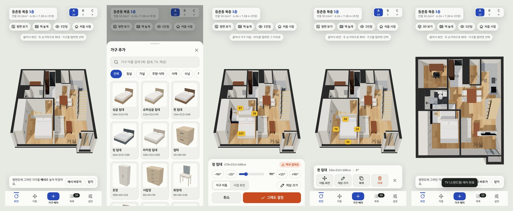

# 등촌동 복층 3D 가구배치

강서구 등촌동 복층 세대 **1층 평면도**를 3D로 옮겨, 가구를 고르고 **색상·크기를 입력해 자유롭게 배치**해 보는 시뮬레이터입니다.
안드로이드 휴대폰에서 **APK로 설치**하거나 **브라우저(크롬)** 로 바로 쓸 수 있습니다.



## 안드로이드에서 쓰는 방법

| 방법 | 설명 |
| --- | --- |
| **APK 설치 (권장)** | 휴대폰에서 [`home-furniture-3d.apk` 받기](https://github.com/Leongoon/APARTMENT-/releases/download/apk-latest/home-furniture-3d.apk) → 파일 열기 → 설치. 처음이면 "출처를 알 수 없는 앱 설치 허용"을 켜야 합니다. 인터넷 없이 동작합니다. |
| 브라우저 | `dist/index.html` 한 파일에 모든 코드가 들어 있습니다. 어떤 정적 호스팅(GitHub Pages 등)에 올려도 크롬에서 그대로 동작합니다. |

APK는 GitHub Actions가 코드가 바뀔 때마다 자동으로 빌드해 [`apk-latest` 릴리스](https://github.com/Leongoon/APARTMENT-/releases/tag/apk-latest)에 올립니다.
같은 서명 키로 빌드하므로 새 APK를 덮어 설치해도 저장해 둔 배치가 유지됩니다.

## 기능

- **3D 평면도**: 벽·문(열림 반경 표시)·현관·신발장·주방 싱크대·욕실(변기·세면대·샤워)·붙박이장·2층 계단까지 배치
- **회전 / 이동 버튼**: `회전`을 켜면 한 손가락으로 3D 회전, `이동`을 켜면 화면 이동. 두 손가락으로 확대·이동
- **다양한 시점**: 3D 보기 ↔ 평면(위에서) 보기, 벽 높이 3단계(높게/반높이/낮게), **1인칭(눈높이) 보기**, 처음 시점으로
  - 3D 보기에서는 카메라 쪽 외벽이 자동으로 낮아져(컷어웨이) 집 안이 가려지지 않습니다
- **가구 배치 흐름**: `가구 배치` → 가구 선택 → **색상·크기(cm) 입력** → `배치하기` → 끌어서 이동, −90°/−15°/+15°/+90° 버튼·슬라이더로 회전 → **`결정`** 을 누르면 그 자리에 설치
  - 배치 중 `시점 회전`을 고르면 가구는 그대로 두고 화면만 돌려 볼 수 있습니다
  - 바닥을 탭하면 가구가 그 자리로 이동합니다
- **겹침 경고**: 벽·붙박이 설비·다른 가구·문 열리는 자리와 겹치면 빨간 윤곽선과 이유를 표시 (의자는 식탁·책상 아래로 넣어도 경고하지 않음)
- **거리 표시(줄자)**: 선택한 가구에서 네 방향 벽·가구까지의 거리를 cm로 표시
- **벽·가구에 붙이기**: 0°/90° 방향일 때 6cm 안으로 가져가면 벽면·가구 옆면에 딱 붙음
- **자동 올림**: TV·모니터·전자레인지·건조기는 거실장·책상·싱크대·세탁기 위에 놓으면 그 높이로 자동으로 올라감. 받침 가구를 옮기면 위의 물건도 함께 이동
- **배치된 가구 편집**: 탭해서 선택 → 이동·회전 / 색상·크기 / 복제 / 삭제(되돌리기 가능)
- **배치안 A·B·C**: 세 가지 배치를 따로 저장해 비교, 다른 안으로 복사
- **도면 크기 보정**: 실측한 실내 가로·세로·천장고를 넣으면 도면 전체가 비례 조정(가구 위치도 함께)
- **저장·공유**: 자동 저장, 화면 저장(PNG), 내보내기/불러오기(JSON)
- 밝은/어두운 테마, 세로·가로 화면, 태블릿·PC(마우스: 왼쪽 드래그 회전, 오른쪽 드래그 이동, 휠 확대, 배치 중 방향키·Q/E·Enter·Esc)

### 가구 목록 (기본 크기, cm: 가로×깊이×높이)

| 분류 | 가구 |
| --- | --- |
| 침실 | 싱글 침대 106×212, **슈퍼싱글** 116×212, **퀸** 156×212, **킹** 166×212, **라지킹** 186×212 (매트리스 1000/1100/1500/1600/1800×2000mm + 프레임), 협탁, 옷장, 서랍장, 화장대, 전신 거울, 행거 |
| 거실 | 2인·3인·4인 **소파**, 카우치(L형) 소파, 1인 소파, **TV**(스탠드형 43~85인치 / 벽걸이), TV 거실장, 소파 테이블, 원형 사이드 테이블, 러그, 플로어 스탠드 |
| 주방·식탁 | 2인·4인·6인 **식탁**, 원형 식탁, 식탁 의자, 스툴 |
| 서재 | **책상(탁상형 테이블)**, **좌식 테이블**, 사무용 의자, 책장, 모니터 |
| 수납 | 수납장, 키큰 수납장, 보조 신발장 |
| 가전 | 양문형·일반 냉장고, 김치냉장고, 드럼 세탁기, 건조기, 전자레인지, 스탠드·벽걸이 에어컨, 공기청정기 |
| 기타 | 대형 화분, **직접 입력(상자)**: 목록에 없는 가구를 이름·크기로 배치 |

모든 가구는 치수에 맞춰 모양이 다시 만들어지므로(단순 늘리기 아님) 크기를 바꿔도 비율이 자연스럽습니다.

## 도면에 대한 가정 (확인 필요)

원본은 네이버페이 부동산 단지정보의 1층 평면도 이미지이며, **치수가 적혀 있지 않습니다.** (원본 이미지는 저장소에 넣지 않았습니다.)

- **축척**: 화면에 표시된 전용면적 **50.16㎡**(벽 중심선 기준)를 1층 외곽선 면적에 맞춰 역산했습니다(약 86px = 1m). 그 결과 실내 크기를 **약 6.36m × 7.38m**로 추정했습니다.
  - 전용면적에 2층이 포함되지 않는다(2층은 다락)는 가정입니다. 2층이 전용면적에 포함되는 구조라면 1층 실제 크기는 더 작습니다.
  - 실측 후 **설정 → 도면 크기 보정**에 넣으면 정확해집니다.
- **방·벽·문 위치**는 이미지를 보고 옮긴 근사치입니다. 문 여는 방향, 침실 위쪽의 계단 모양 단차, 오른쪽 아래 작은 공간(실외기실로 추정)은 이미지로는 확실하지 않습니다.
- **창문 위치**와 **2층(다락)** 은 평면도에서 확인할 수 없어 넣지 않았습니다.
- 천장고는 2.3m로 가정했습니다(설정에서 변경 가능).

## 개발

```bash
npm ci
npm run build       # dist/index.html, dist/artifact.html, android/app/src/main/assets/index.html 생성
npm test            # 기하 계산·카탈로그·저장·도면 데이터 단위 테스트
npm run test:e2e    # 헤드리스 Chromium으로 모바일 화면 동작 확인 + 스크린샷(dist/e2e)
npm run dev         # 수정 시 자동 빌드 + http://localhost:5173
```

APK 직접 빌드 (JDK 17, Android SDK 필요):

```bash
npm ci && npm run build
cd android && ./gradlew assembleRelease   # → app/build/outputs/apk/release/app-release.apk
```

### 구조

| 경로 | 내용 |
| --- | --- |
| `src/planData.js` | 평면도 데이터(벽·문·설비·방, m 단위)와 크기 보정 |
| `src/plan3d.js` | 도면 → 3D 장면, 충돌·측정용 장애물, 외벽 컷어웨이 |
| `src/catalog.js` | 가구 카탈로그·규격 프리셋·색상 팔레트 |
| `src/models.js` | 치수 기반 가구·설비 3D 모델 |
| `src/geom2d.js` | 겹침 판정(SAT), 벽 자석, 거리 측정 |
| `src/viewer.js` | 렌더러·카메라·시점 전환·1인칭 |
| `src/main.js` | 화면 구성, 배치 흐름, 입력 처리 |
| `src/store.js` | 저장·검증·내보내기, 예시 배치 |
| `android/` | WebView 래퍼 앱(Java). 내장 `index.html`을 띄우고 파일 저장·뒤로가기를 연결 |
| `.github/workflows/android-apk.yml` | 테스트 → 웹 빌드 → APK 빌드 → `apk-latest` 릴리스 갱신 |

`android/app/debug.keystore`는 개인 설치용 고정 서명 키입니다(비밀번호 `android`). Play 스토어 배포용이 아닙니다.

## 라이선스

3D 렌더링에 [three.js](https://threejs.org/) (MIT License, © 2010-2024 three.js authors)를 사용합니다.
